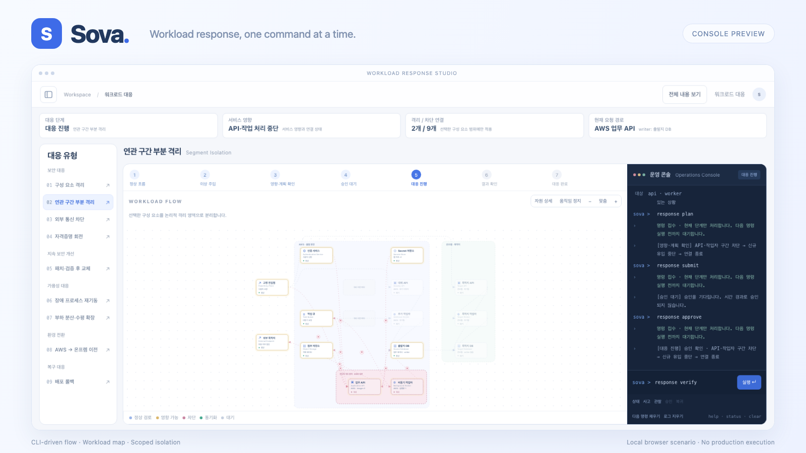

# Sova

[](docs/assets/thumbnail.png)

개인 개발 브랜치의 워크로드 대응 콘솔 미리보기입니다. 로컬 브라우저 시나리오이며 실제 운영 이전·격리 검증 결과가 아닙니다.

운영 중인 서비스를 다른 환경으로 이전하고, 기능·데이터·보안의 보존 여부를 검증하는 독립 제어 플랫폼.

**조사 → 이전 계획 → 격리 리허설 → 승인 → 실행·복구 → 운영 관측**을 연결한다. Python은 제어면을 담당하고, 앱 실행의 첫 통합 대상은 Kubernetes다. k3s를 첫 검증 환경으로 삼는다.

## 팀 저장소와의 관계

이 저장소는 이상무의 개인 개발 프로토타입과 통합·시연 환경을 보존한다. 팀 최종 제품은 [platform](https://github.com/Softbank-Hackathon-Finals/platform)에서 개발하며, 검증된 보안 기능은 [security](https://github.com/Softbank-Hackathon-Finals/security)의 독립 패키지로 추출해 통합한다. 보안 핵심은 `sova-security` 패키지로 추출했으며, Sova의 기존 import는 설치한 패키지에 연결한다. 실제 작업 실행 조정기와 시험 환경 어댑터는 Sova에 남긴다. 팀 platform 통합 완료를 뜻하지 않는다.

초기 23개 커밋은 기존 로컬 작업물을 기능별로 나눠 재구성한 이력이다. 작성일은 기능별 파일의 최종 수정 시각을 사용했고, 실제 Git 커밋 시각은 별도로 유지했다. 원래의 점진적 개발 이력을 복원한 것은 아니다.

## 시작

Python 3.11 이상을 사용한다. 다음 명령은 클라우드 자원을 생성하지 않는다.

```sh
python3 -m venv .local-notes/venv
# 먼저 팀 security 저장소를 ../team-bravo/security에 받고 설치한다.
.local-notes/venv/bin/python -m pip install -e ../team-bravo/security
.local-notes/venv/bin/python -m pip install -e '.[dev]'
.local-notes/venv/bin/sova example > .local-notes/example.json
.local-notes/venv/bin/sova inspect .local-notes/example.json
.local-notes/venv/bin/sova assess .local-notes/example.json --target-environment customer-k3s --target-backend kubernetes
```

예제는 1시간 유효한 가상 등록이다. 결과는 **검토 제안**이며 배포 승인이나 실제 이전 성공이 아니다. Kubernetes 내보내기 파일도 범위를 지정해 읽을 수 있다. [입력 예제](examples/README.md)를 참고한다.

## 구성

```text
src/sova/
  security/        # 보안 통제·비교·보류·게이트·증거·어댑터
    domain/        # 설치한 보안 패키지로 연결하는 import 경로
    application/   # 수집·비교·승인된 대응·검증
    ports/         # 보안 저장소·근거 경계
    adapters/      # 패키지 어댑터 연결·호스트 소유 응답 SQL
    qualification/ # 등록된 로컬 k3s 전용 격리·권한 검증
  domain/          # 공통 그래프·계획·검증 의무·실행 계약
  application/     # 공통 접수·실행·복구·이전
  ports/           # 공통 저장소·외부 실행·조사 경계
  adapters/        # 공통 PostgreSQL·Kubernetes·Harbor 작업 준비
  monitoring/      # 등록된 감시 작업·인증된 입력·고정 워커
  interfaces/      # 플랫폼 CLI
console/src/
  features/security/  # 보안 화면과 시나리오 표시
  features/migration/ # 환경 이전 화면
  features/demo/      # 프로세스 실험 제어
  components/         # 공통 지도·검증 범위 표시
demo/              # 개인 시연 API·일회용 로그인·실험 실행기
infra/             # 시연 환경 인프라와 실행 도구
examples/          # 시험앱 및 비밀값 없는 등록·입력 예제
integration/security/ # 팀 통합 시 필요한 공통 계약·의존성
tests/security/    # 보안 단위·PostgreSQL 통합 시험
tests/demo/        # 시연 API·콘솔·실험 실행 회귀
tests/unit/        # 공통 제어면 단위 시험
tests/integration/ # 공통 통합 시험과 공유 PostgreSQL fixture
```

프론트엔드는 `console/`, 시연 서버·실험 도구는 `demo/`를 사용한다. 예전 최상위 경로의 호환 링크는 제거했다. 이전 보안 Python import 경로는 동일한 모듈로 연결하며, 새 코드는 `sova.security.*`를 사용한다.

팀 보안 통합의 시작점은 [통합 명세](integration/security/manifest.json)다. 보안 판정·저장소 어댑터는 독립 `sova-security` 패키지를 사용한다. 공통 scope·계획·증거는 패키지의 v1 경계 계약으로 연결하며 승인·작업 원장·실제 실행은 Sova가 담당한다. `qualification/`은 등록된 시험 환경 전용이며 일반 고객 환경의 프로덕션 어댑터로 간주하지 않는다. Harbor runner 구현은 기존 담당 경계를 유지한다.

`demo/`는 개인 검증 경로다. 시연 HTTP API와 일회용 인증은 이곳에 있으며 팀 플랫폼의 인증·API와 연결할 때 별도로 조정한다. 새 제어면과의 연결 여부를 [구현 현황](docs/implementation-status.md)에 구분한다. [이전 프리뷰 안내](docs/preview-guide.md)의 과거 검증이 현재 서버 가동을 의미하지 않는다.

등록한 Kubernetes API를 직접 조회하는 운영자 CLI는 [읽기 전용 조사 안내](docs/kubernetes-discovery.md)를 따른다. 전용 로컬 k3s에서 제한된 RBAC·격리 시험을 마쳤으며 기업 OIDC와 다중 환경 운영 자격은 아직 연결하지 않았다.

## 설계

`sova-security==0.11.1`의 T14·T33 오프라인 인수 준비는 `sova security-intake-plan`을
사용한다. 기존 정본의 20개 full 시험과 제출 원문의 보고 상태를 정리하며 실제 클라우드
검사·증거 인증·실행 승인으로 사용하지 않는다. [맥 인수 안내](docs/platform-security-handoff.md)를 따른다.

두 보안 제안서의 패치·마이그레이션 검증 흐름은 설치한 `sova-security==0.11.1`의
검사 프로필을 사용한다. [실행 예와 플랫폼 인계](docs/platform-security-handoff.md)에
독립 패키지, 기존 실행기 연결, 원문 요구사항과 시험 범위를 정리했다.
`sova security-program-catalog`, `sova security-program-example`,
`sova security-program-check`로 로컬 진단을 실행할 수 있다.
진단 JSON은 인증·승인·실제 클라우드 검사 결과가 아니다.

실제 로컬 k3s의 보안 수집·보류·승인된 격리·대체 기동·경로 전환은 [검증 현황](docs/security-workload-validation.md)에 정리했다. 클라우드 간 이전·무중단·기업 인증 완료를 뜻하지 않는다.

여섯 영역의 검증 계약과 데이터·보안·관측 경로를 구현 중이다. Harbor 실행 연동은 팀원 담당이다. [담당 경계](docs/team-boundaries.md) · [보안 실행 계약](docs/security-governance.md).

[React 운영 콘솔](console/README.md)은 워크로드 지도와 보안 대응을 같은 인증 화면에 제공한다. 로컬 프로세스 실험과 k3s 실행은 별도 경로로 표시하며, 실제 관측·승인·미확인을 유지한다.

- [상담 reference workload](examples/README.md#상담-reference-workload): 실제 PG·파일·WebSocket·멱등·OTel 시험
- [보호 수준 비교](docs/protection-parity.md): 최소 보호 목적·근거·발행자 신뢰·실행 차단
- [RDS 읽기 전용 조사](docs/aws-rds-security.md): 구현 범위와 실계정 미검증 항목

- [기준 명세 v2](docs/sova-production-spec-v2.md): 제품 책임·서비스/배치 아키텍처·핵심 결정
- [상세 설계](docs/design/README.md): 이전, 목적지 재현, AI·데이터 위치, 샌드박스, 비용·관측, 거버넌스
- [구현 현황](docs/implementation-status.md) · [진행 순서와 완료 기준](docs/roadmap.md)
- [편집 가능한 아키텍처 2장](docs/diagrams/sova-target-architecture.drawio)

## 검증

```sh
.local-notes/venv/bin/ruff check src tests demo
.local-notes/venv/bin/python -m pytest -q
```

일반 실행에서는 실제 PostgreSQL 시험이 건너뛰어질 수 있다. 전체 검증에는 **격리된 시험용 PostgreSQL**과 `SOVA_TEST_POSTGRES_DSN`이 필요하다. 운영 DB를 지정하지 않는다. [DB 시험 조건](docs/postgres-execution.md)을 따른다.

Sky에서 확인한 구현은 이식 후보와 회귀 시나리오로 참조한다. Sova의 구현·운영 자격으로 합산하지 않는다. 개발기록·실행 등록·비밀값은 `.local-notes/`에 보관하며 게시하지 않는다.

패키지 소유 SQL은 `sova.adapters.sql_resources.migration_sql`을 통해 읽는다. `operations` 상태·경로·완료 트랜잭션은 Sova 소유 SQL을 유지한다. source-tree SQL 링크로 외부 저장소를 참조하지 않는다.

검증된 이미지 교체는 [Kubernetes 이미지 어댑터](docs/kubernetes-image-patch.md), 감시 작업·실패 경보와 운영 연결 조건은 [감시 워커](docs/security-monitoring.md)를 참고한다. 두 기능의 조립 시험과 외부 상시 운영 완료는 구분한다.
