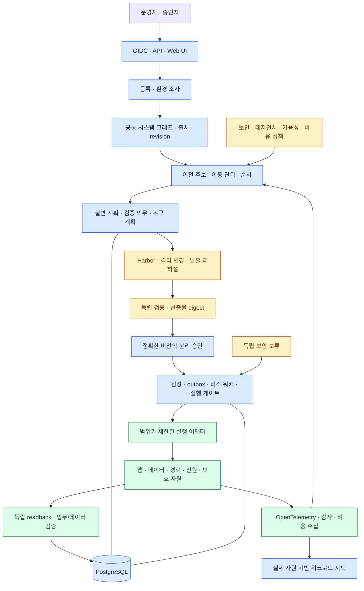
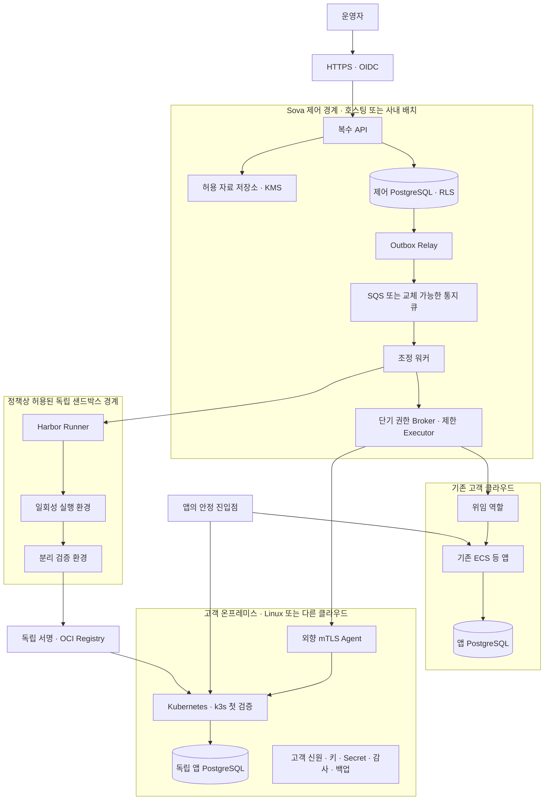

# Sova 프로덕션 목표 명세 v2

개정일: 2026-11-01 · 상태: 독립 제품의 구현 기준 · 운영 자격 획득 전

## 1. 제품과 문제

운영 시스템의 이전은 컨테이너 재실행으로 끝나지 않는다. 데이터, 신원, 키, 네트워크, 외부 AI, 관측, 백업과 비용의 종속성이 함께 바뀐다. Sova는 이 차이를 조사하고, 승인 가능한 계획으로 만들고, 이전 후의 기능과 보호 수준을 검증한다.

주 사용자는 서비스 운영 책임을 가진 개발·플랫폼·보안 팀이다. 자연어 요청은 의도 입력이며 실행 권한을 부여하지 않는다. 신규 ZIP·GitHub 앱 배포와 기존 운영 시스템 편입은 서로 다른 등록 경로다.

핵심 차별점은 **점진적 클라우드 탈출과 탈출 리허설**이다. 이동 단위와 잔류 의존성을 명시하고, 출발지 의존성을 차단한 격리 환경에서 업무 시나리오를 재검증한다. 허용한 중간 구성과 완전한 탈출을 다른 완료 상태로 기록한다.

## 2. 독립성과 기준

Sova는 독립 제품·패키지·제어 상태를 가진다. Sky 서비스에 새 메뉴를 붙이는 방향으로 개발하지 않는다. Sky의 검증 자산은 출처와 변경 범위를 기록하고 선택적으로 이식한다. 핵심 패키지는 Sky를 import하지 않는다. 이전 AWS 프리뷰 준비 스크립트의 환경 의존성은 남아 있으며 독립 설치 도구로 제공하지 않는다.

이 문서는 최신 기술 선택의 기준이다. [v1.1](sova-production-spec-v1.md)의 INV-01~10, 실행 원장·게이트·데이터 이전 자격과 QA 기준은 폐기하지 않고 이어받는다. 내용이 충돌하면 이 문서의 명시적 결정이 우선한다. 기존 PDF는 역사적 스냅샷이며 자동 갱신되지 않는다.

## 3. 아키텍처 결정

| 결정 | 채택 내용 | 경계 |
| --- | --- | --- |
| 제어면 | Python의 독립 도메인·유스케이스·port/adapter | 사용자 앱을 Python 프로세스로 제한하지 않음 |
| 실행 상태 | PostgreSQL 원장·outbox·앱 실행권·리스 워커 | 큐는 통지, 실행 정본은 DB |
| 앱 실행 | Kubernetes adapter를 첫 통합 대상으로 개발, k3s로 첫 자격 검증 | 기존 ECS·VM·관리형 DB도 별도 어댑터. 모든 자원을 클러스터로 이동하지 않음 |
| 작업 조정 | 기존 PostgreSQL 상태 머신 확장 | Temporal은 추후 장애·운영비 비교 후 결정. 이중 정본 금지 |
| 샌드박스 | Harbor Framework 작업·평가 어댑터 | OCI registry Harbor와 다름. 격리 backend의 운영 자격은 별도 |
| 지도 | 공통 시스템 그래프 + 실제 실행·관측 이벤트 | 고정 A~F 그림, 단순 인접 관계로 공격 판정 금지 |
| 데이터 | 앱 DB와 제어 DB 분리, writer 전환은 별도 계약 | Pod 갱신·경로 변경이 DB 이전을 대체하지 않음 |
| 보안 | 정책 게이트·독립 보류·단기 범위 권한·독립 검증 | AI는 정책 우회·승인·자격 증명 발급 불가 |

## 4. 서비스 구조

이는 목표 구조다. 실제 연결 상태는 [구현 현황](implementation-status.md)이 정본이다.

## 5. 배치 구조

AWS 호스팅 선택 시 API·워커는 Fargate, 상태는 RDS PostgreSQL, 자료는 S3, 비밀은 Secrets Manager/KMS로 구성할 수 있다. 사내 배치도 같은 port 계약을 따른다. 이 배치 선택이 사용자 앱의 배치 후보를 제한하지 않는다.

원문 반출 금지 조직은 AI Gateway·샌드박스·관측·자료를 고객 경계 안에 둔다. 앱 진입점, registry, DNS, 키와 백업이 출발 클라우드에 남으면 그 종속성을 지도와 완료 판정에 남긴다.

## 6. 공통 시스템 그래프

자원은 `tenant / app / environment / resource` 범위, 유형, backend, 위치, resource revision, 출처·유효기간, 이식성 주장과 검증 의무를 가진다. 관계는 호출·읽기·쓰기·사용·복제로 분류한다. 등록 주장, 선언된 연결, 실제 관측과 검증 완료를 다른 사실로 보존한다.

순환 의존성은 SCC로 묶어 함께 검토한다. 이것이 반드시 같은 환경으로 동시에 이동해야 한다는 뜻은 아니다. 허용한 잔류 연결, 보안 경계와 데이터 지연을 정책으로 재평가한다. 임의의 지도 노드 하나를 눌러 주변을 자동 격리하지 않는다. 실제 변경 범위·공유 자원·관리 경로를 계획과 승인에 결합한다.

현재 구현의 이식성 분류는 등록된 주장을 정규화한다. 클라우드 SDK 자동 조사, 소스 분석·AI 판정, 실제 비용 최적화나 실행 가능한 이전 계획 생성이 완료된 상태는 아니다.

## 7. 필수 실행 불변식

1. 계획·승인·자료·이미지·환경·정책 revision이 일치해야 한다.
2. 외부 효과의 의도를 먼저 기록한다. 불명확한 결과는 재실행하지 않고 조회·보류한다.
3. 앱별 실행권이 있어도 실제 writer fencing을 별도로 확인한다.
4. 근거의 누락·만료·수집 오류는 미확인이다. 다음 게이트가 부담할 의무도 원장에 남긴다.
5. 다른 앱·조직·계정의 자원을 변경하지 않는다. 공유 자원 변경은 별도 영향·승인 범위다.
6. 일반 승인은 독립 보안 보류를 해제하지 않는다.
7. 제어면 장애가 정상 앱을 중단하거나 writer를 임의 전환시키지 않는다.
8. 신규 쓰기 이후 복귀는 데이터 보존 검증이 포함된 복구 작업이다.
9. 동일 이미지 digest도 설정·Secret·런타임·DB 차이까지 동일함을 증명하지 않는다.
10. 완료 주장은 통과한 경로·버전·부하·정책과 증거의 범위를 벗어나지 않는다.

## 8. 상세 설계와 완료 기준

[상세 설계 목록](design/README.md)의 여섯 영역을 하나의 목표로 유지한다. 구현 순서는 범위 축소가 아니라 자격 검증의 의존 순서다. [로드맵](roadmap.md)에 각 단계의 산출물과 통과 조건을 둔다.

첫 업무 경로는 HTTP 주문 처리와 PostgreSQL을 사용한다. 기존 게임은 추가 워크로드이며 제품 구조를 결정하지 않는다. 초기 자격은 `bounded_write_pause`다. 이후 정한 오류·지연·쓰기 완료·연결 기준을 부하 시험으로 만족한 경로에만 `continuous_service_qualified`를 부여한다.

프로덕션 운영 전에는 다중 테넌트 인증·실제 provider fencing·HA/DR·백업 복구·키 회전·공급망·부하·업그레이드·장애 주입과 운영 절차를 검증해야 한다. 설계 문서나 단위 시험 통과로 이를 갈음하지 않는다.
