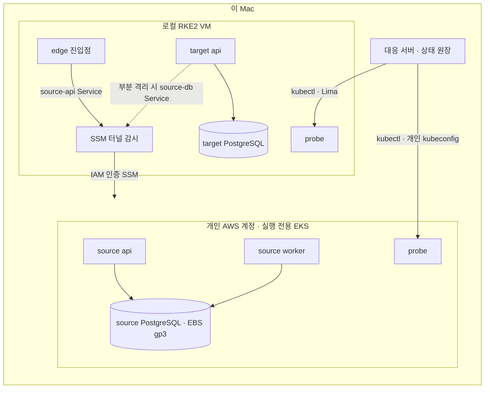

# 워크로드 대응 실제 실행기

워크로드 대응 화면(`demo/response_scenarios`)의 9개 대응 유형을 실제 클러스터에서 실행하는 실행기다. 화면은 단계마다 서버에 정확한 명령을 보내고, 서버는 실행 결과를 실제 Kubernetes·HTTP·PostgreSQL 관측으로 확인한 뒤에만 다음 단계로 넘긴다. 확인하지 못한 효과는 보류(`held`)하고 자동으로 다시 실행하지 않는다.

## 두 가지 배치

한 프로세스는 상태 폴더의 `settings.private.json`에 적힌 배치 하나만 쓴다.

| 배치 | 출발지 | 목적지 · 진입점 · probe | 용도 |
|---|---|---|---|
| `local` | 이 Mac의 RKE2 (`sova-response-source`) | 같은 RKE2 (`sova-response-target`, `sova-response-control`) | 빠른 로컬 기준선 |
| `hybrid-aws` | 실행 전용 EKS (`sova-hybrid-source`, 같은 클러스터의 probe) | 이 Mac의 RKE2 (`sova-hybrid-target`, `sova-hybrid-control`) | AWS 출발지 → 온프렘 목적지 |

두 배치는 소유자 라벨(`sova.io/owner`), 네임스페이스, StorageClass, PV 이름이 모두 다르다. 같은 로컬 클러스터에 함께 있어도 서로의 자원을 바꾸지 않는다.



## 하이브리드 경로의 경계

- **클러스터를 오가는 경로는 SSM 터널 하나다.** 로컬 Pod는 `source-api`, `source-db` Service로 나간다. 이 Service의 EndpointSlice는 Lima가 Mac 루프백으로 넘기는 `192.168.5.2`를 가리킨다. Mac에서는 `session-manager-plugin`이 SSM 세션을 열고, EKS 노드가 출발지 Service ClusterIP로 전달한다. 출발지에는 공개 LoadBalancer나 공개 DB 포트가 없다.
- **EKS 쪽에서 이 Mac으로 오는 경로는 없다.** `host()`는 출발지에서 목적지로 가는 주소를 만들지 않는다.
- **격리는 규칙만 바꾸고 선택자는 바꾸지 않는다.** 격리할 수 있는 출발지 역할(api, worker)은 공용 `namespace-boundary` 허용에서 처음부터 빠지고, 각자 자기 허용 정책(`allow-api`, `allow-worker`)만 적용받는다. 격리·발신 제한·복구는 이 정책의 규칙만 바꾼다. EKS VPC CNI 1.22의 정책 에이전트는 Pod가 어떤 정책의 선택자에서 빠질 때 그 정책의 허용 항목을 eBPF 맵에 남겼다. 그래서 차단 정책을 적용한 뒤에도 작업자가 새 연결을 받았고, 실행기가 이를 확인하지 못해 보류했다. 선택자를 옮기는 방식은 쓰지 않는다. 예전 방식의 `isolate-*` 정책은 첫 초기화 때 지우고, 초기화가 api·worker를 새 ReplicaSet으로 다시 띄워 남은 맵을 버린다.
- **터널 허용 범위를 좁힌다.** 브리지 트래픽은 노드 주소에서 들어온다. 노드 IP(/32)만 허용한다. api 포트 허용은 `allow-api`의 정상 규칙 안에 있어서 격리하면 함께 빠지고, db 포트 허용은 고정된 `bridge-ingress`에 있다. VPC CNI에서는 Pod도 노드와 같은 서브넷 IP를 받으므로, 서브넷 범위로 허용하면 클러스터 안의 모든 Pod가 허용된다.
- **터널 감시는 허용된 노드로만 연결한다.** 노드가 교체되면 연결할 노드가 없어 터널이 끊기고, 관측이 실패해 보류된다. `python3 -m local_response.hybrid --state $H/runtime --refresh-bridge`로 현재 노드를 다시 허용한다.
- **NetworkPolicy는 실제로 집행된다.** EKS에서는 VPC CNI의 network policy agent가, 로컬에서는 Calico가 집행한다. VPC CNI는 정책을 비동기로 적용하므로 수 초가 걸린다. 그래서 격리 뒤에는 실행 중인 Pod가 새 연결을 거부하는 것을 최대 45초까지 다시 확인한 다음에 진행한다. 정책을 쓴 것만으로는 집행으로 보지 않는다.
- **충돌과 실패를 구분한다.** Deployment 변경은 `resourceVersion` test가 들어간 JSON Patch로 한다. 상태 갱신으로 test가 실패하면 아무것도 적용되지 않으므로, 다시 읽어 최대 3번 시도한다. exec로 만드는 효과는 자동으로 다시 실행하지 않는다. 보류 기록에는 kubectl 실패 종류(rejected, unauthorized, timeout, connection 등)만 남고 stderr는 남기지 않는다.
- **판정은 각 클러스터 안에서 한다.** 출발지 HTTP·SQL 확인은 EKS 안의 probe가, 목적지·진입점 확인은 로컬 probe가 한다. 데이터 전환은 제어 호스트가 출발지 DB를 읽고 목적지 DB에 쓰는 제한된 stop-and-copy다(2,000행 상한). CDC나 무중단 복제를 주장하지 않는다.
- **이미지는 digest로 고정한다.** EKS는 실행 전용 ECR(태그 변경 불가, 푸시 시 검사)의 digest를 쓰고, 로컬은 containerd에 들여온 digest를 쓴다. 같은 소스(`workload.py` 해시 기록)에서 만든 ARM64 이미지다.
- **자격 증명은 개인 상태에만 둔다.** DB·관리 토큰, kubeconfig, EKS 토큰 캐시는 상태 폴더(0700)의 0600 파일이다. kubeconfig는 정적 토큰 없이 `eks_token`으로 15분짜리 토큰을 받는다.

## 실행 순서

```bash
H=<개인 상태 폴더>   # 예: .local-notes/validation/hybrid-response-YYYYMMDD
# 1. AWS 출발지 (개인 계정, 실행 전용)
cd infra/aws-response-source
TF_DATA_DIR=$H/terraform/.terraform terraform init -backend-config=path=$H/terraform/terraform.tfstate
TF_DATA_DIR=$H/terraform/.terraform terraform apply -var-file=$H/terraform/run.auto.tfvars.json
# 2. 이미지 푸시 · 두 클러스터 배포 · DB 초기화
cd ../../demo
python3 -m local_response.hybrid --state $H/runtime \
  --terraform-state $H/terraform/terraform.tfstate --local-state <local 배치 상태 폴더>
# 3. SSM 터널 감시 (최대 12시간)
SOVA_SSM_PLUGIN_DIR=<session-manager-plugin 폴더> python3 -m local_response.bridge --state $H/runtime --hours 8
# 4. 9개 유형 순차 검증 (서버를 띄우기 전, 같은 잠금 사용)
python3 -m local_response.qualify --state $H/runtime
# 5. 화면 서버와 화면 경로 검증
python3 -m local_response.server --state $H/runtime --hours 8
python3 -m local_response.http_qualify --state $H/runtime --until <ISO 시각>
```

`run.auto.tfvars.json`에는 `account_id`, `operator_arn`, `operator_cidr`(EKS API 공개 접근을 허용할 운영자 /32), `run_id`, `expires_at`을 둔다. 커밋하지 않는다.

`http_qualify`는 브라우저와 같은 경로로 실행한다. 즉 일회용 접속 토큰 교환, 세션 쿠키, CSRF 헤더를 거쳐 `/api/scenario`·`/api/command`·`/api/state`를 호출한다. 일회용 토큰을 쓰므로, 끝나면 사람이 쓸 수 있도록 서버를 다시 띄운다.

## 증거

상태 폴더에 남는다. 값이 아닌 판정만 기록한다.

- `qualification-*.json`: 실행 커밋, 실행기 파일 해시, 두 클러스터 UID, 유형별 검사 결과
- `http-qualification-*.json`: 화면 경로 반복 실행 결과(주기·유형·소요 시간·검사)
- `bridge-status.json`: 터널별 노드·재시작 횟수·수신 여부
- `latest-evidence.json`: 마지막 실행 직후의 상태와 관측

## 자격 회수의 실효

자격 회전은 새 로그인 거부만으로 회수 완료로 보지 않는다. PostgreSQL은 비밀번호를 바꿔도 이미 인증한 세션을 끊지 않는다. 회전 전에, 회전 때 재시작하지 않는 이웃 Pod(`objects`)에서 현재 자격으로 앱 세션을 열고 계속 쿼리하게 둔다. 회전은 비밀번호 변경과 함께 앱 계정의 기존 세션을 모두 종료한다.

다음 세 가지를 따로 검사한다(명세 S.4).

- 그 세션이 서버 쪽에서 실제로 끊겼는지(`pre_rotation_session_terminated`)
- 이전 자격의 새 로그인이 거부되는지(`previous_credential_rejected`)
- 새 자격이 동작하는지

앱 수준 토큰이나 외부 API 세션의 회수는 이 시험 범위가 아니다.

## 비용과 정리

하이브리드 출발지는 EKS 제어 평면, t4g.medium 2대, EBS, 로그 3일 보관으로 시간당 약 0.2달러다. NAT 게이트웨이는 쓰지 않는다. 노드는 공개 서브넷에 있지만, 들어오는 트래픽은 EKS가 관리하는 클러스터 보안 그룹만 허용한다. 모든 자원에 `component=sova-response-hybrid-source`, `RunId`, `ExpiresAt` 태그가 붙는다.

정리 순서:

1. 서버와 터널 감시를 멈춘다.
2. `terraform destroy`를 실행한다. ECR 저장소는 `force_delete`로 함께 지워진다. EBS 볼륨은 StorageClass `Delete`라서 PVC와 함께 지워진다. 남는 볼륨이 없는지는 `RunId` 태그로 확인한다.
3. 로컬의 `sova-hybrid-*` 네임스페이스와 PV는 데이터 보존을 위해 자동으로 지우지 않는다.

## 범위 밖

운영 환경, 팀 공용 AWS 계정, 모의해킹 검증은 이 실행기의 범위가 아니다. EKS 관리형 노드 그룹이나 IAM 연동 같은 관리형 기능도 클러스터 생성 이상으로는 검증하지 않는다. 통과 기록은 위 배치와 경로에 대한 것이다.
